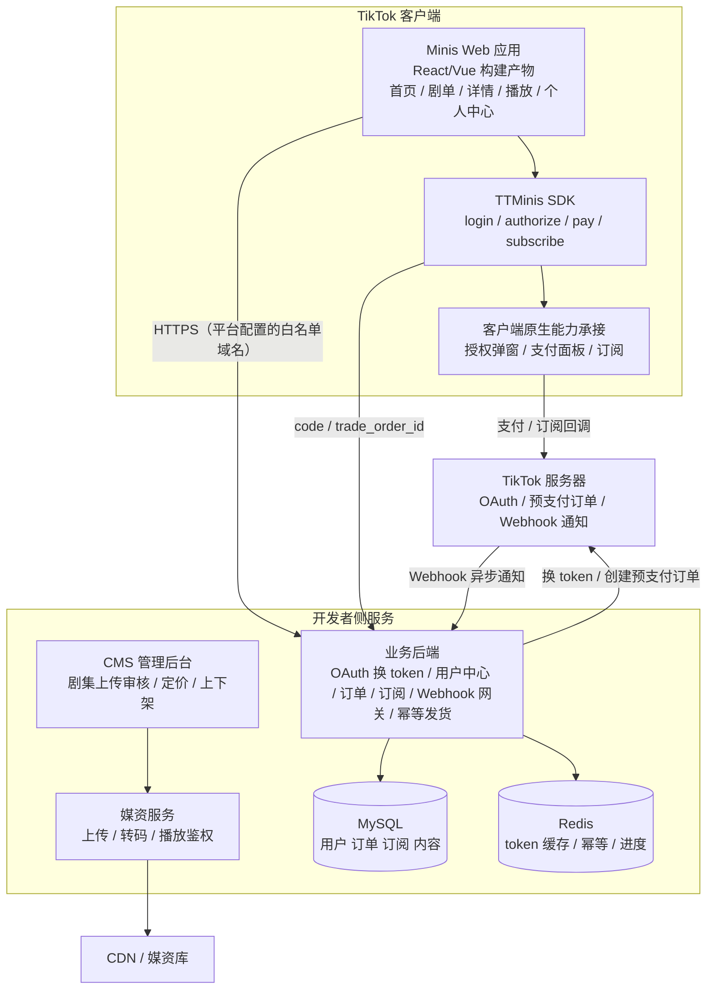
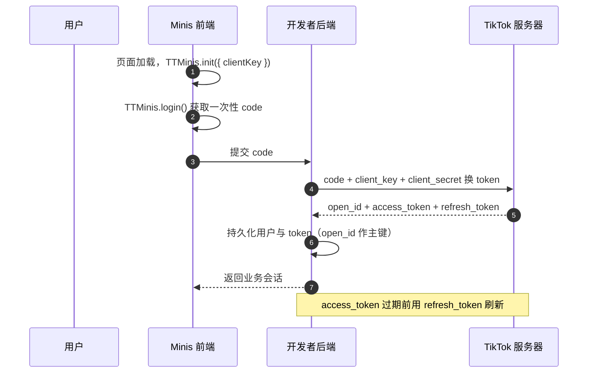
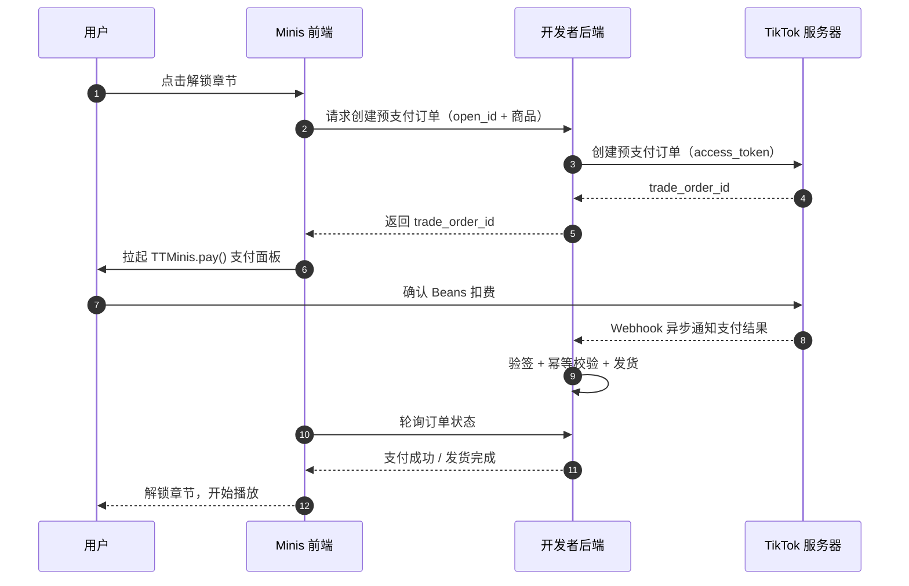

# 漫剧开发架构

## 业务拆解

漫剧 = 竖屏漫画风短剧，业务本质是**内容付费**，核心链路：

```
内容生产(CMS 上传) → 剧集展示 / 免费集引流 → 静默登录建身份 → 显示授权拿资料
    → 付费解锁章节(IAP) / 订阅会员(Subscription) → Webhook 发货 → 播放权益校验
```

### 功能模块

| 模块 | 前端（Minis Web） | 后端 |
| --- | --- | --- |
| 剧集内容 | 首页 / 剧单 / 详情页 / 播放页 | 内容 API、上下架管理 |
| 媒资播放 | 播放器（优先平台短剧媒资库播放器） | 媒资上传 / 转码 / 存储对接 |
| 用户体系 | 静默登录 + 显示授权 | OAuth 换 token、用户中心、`open_id` 主键 |
| 付费解锁 | `TTMinis.pay()` 拉起支付面板 | 预支付订单、Webhook 验签、幂等发货 |
| 订阅会员 | `TTMinis.subscribe()` 端内订阅 | 订阅管理、续费 / 退订 Webhook、权益校验 |
| 内容上传（CMS） | 后台管理系统（独立 Web，不在 Minis 内） | 上传、审核、发布流水线 |
| 数据运营 | 个人中心（观看进度 / 已购 / 订阅状态） | 进度同步、订单库、数据埋点 |

## 整体架构



## 前端设计

### 页面清单

| 页面 | 功能 | 关键能力 |
| --- | --- | --- |
| 首页 | 剧单推荐、榜单 | 内容 API |
| 剧集详情页 | 剧集介绍、集数列表、定价 | 免费集 / 付费集标识 |
| 播放页 | 竖屏播放器、解锁提示、自动续播 | 媒资播放器、权益校验 |
| 个人中心 | 观看进度、已购、订阅状态 | login + authorize |
| 付费浮层 | 解锁单集 / 开通订阅 | `TTMinis.pay` / `TTMinis.subscribe` |

### 技术选型建议

| 项 | 建议 | 说明 |
| --- | --- | --- |
| 框架 | React 18 + Vite（或 Vue 3） | 标准 Web 工程即可，团队熟悉优先 |
| SDK 封装 | `services/ttminis.ts` 统一封装 | 集中处理 login / authorize / pay / subscribe 与错误兜底 |
| 状态管理 | zustand / pinia + 后端会话 | 轻量即可 |
| 播放器 | 平台短剧媒资库播放器 | 调试工具已支持媒资库播放器调试，省转码成本 |
| 监控 | 埋点 + 错误上报 | 支付转化漏斗是漫剧核心指标 |

## 后端设计

### 服务划分

| 服务 | 职责 |
| --- | --- |
| 业务 API | 内容、用户、订单、订阅、进度接口 |
| Webhook 网关 | 统一接收支付 / 订阅回调，验签后入队 |
| 发货服务 | 消费队列，幂等发货（增加已购权益） |
| CMS 管理后台 | 剧集上传 / 审核 / 定价 / 上下架 |
| 媒资服务 | 上传、转码（或平台媒资库）、播放鉴权 |

### 核心数据模型

| 表 | 关键字段 | 说明 |
| --- | --- | --- |
| `users` | `open_id`（唯一索引）、`access_token`、`refresh_token`、`token_expire_at`、`nickname`、`avatar` | `open_id` 为业务主键 |
| `dramas` | `id`、`title`、`cover`、`status` | 剧集 |
| `episodes` | `id`、`drama_id`、`seq`、`video_url`、`price`、`is_free` | 集 |
| `orders` | `id`、`trade_order_id`（唯一索引）、`user_id`、`episode_id`、`amount`、`status` | 唯一索引防重复发货 |
| `subscriptions` | `id`、`user_id`、`plan_id`、`status`、`expire_at`、`platform_sub_id` | 订阅 |
| `play_progress` | `user_id`、`episode_id`、`position`、`updated_at` | 观看进度 |

### 接口清单

| 模块 | 接口 |
| --- | --- |
| 认证 | `POST /api/auth/login`（code 换业务会话） |
| 内容 | `GET /api/dramas`、`GET /api/dramas/:id`、`GET /api/episodes/:id` |
| 播放鉴权 | `GET /api/episodes/:id/playback`（校验免费 / 已购 / 订阅有效） |
| 支付 | `POST /api/orders`（创建预支付订单）、`GET /api/orders/:id`、`POST /api/webhook/pay` |
| 订阅 | `POST /api/subscriptions`、`POST /api/webhook/subscribe` |
| 进度 | `PUT /api/progress` |

## 核心链路时序

### 静默登录



### 端内支付（Beans 解锁章节）



## 媒资方案

| 方案 | 说明 | 建议 |
| --- | --- | --- |
| A：平台短剧媒资库 | 内容上传到平台，使用媒资库播放器播放 | **推荐先走**，省转码与 CDN 成本 |
| B：自建 CDN + 转码 | 自有媒资链路 | 注意跨境播放质量与成本，量级上来后再评估 |

## 环境与部署

- 测试环境：后端测试集群 + 平台测试 App（test user 权限）
- 生产环境：后端生产集群 + 平台正式 App
- 请求域名必须在 TikTok for Developers 平台配置白名单
- 支付 / 订阅 Webhook 回调地址在平台配置（建议 https，接收验签）
