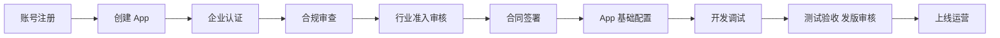

# 接入全流程

> 来源：[小程序短剧接入 One Page（Lark）](https://bytedance.larkoffice.com/wiki/MJ2BwFqSxi4r2SkwHS8cRrlsnVb)

## 流程总览

短剧 Minis 基于 TikTok 移动网页技术框架，用户在 TikTok 内无需下载安装即可观看第三方短剧内容。入驻共 10 步：

| # | 步骤 | 说明 | 建议周期 | 关键注意 |
| --- | --- | --- | --- | --- |
| 1 | 账号注册 | [TikTok for Developers](https://developers.tiktok.com/) 注册，进入 My organizations 管理组织 | 1 天 | — |
| 2 | 创建 App | 创建 Minis 应用，获得 `clientKey` / `clientSecret` | 1 天 | 密钥仅存后端 |
| 3 | 企业认证 | 主体认证（企业） | 3~7 天 | 必须 |
| 4 | 合规审查 | 隐私政策、服务条款、内容合规 | 2~4 周 | **尽早启动，最容易卡住** |
| 5 | 行业准入 | 短剧类目准入审核 | 1~2 周 | 与 4 并行推进 |
| 6 | 合同签署 | 商务合同，确定结算方式（线上 / 线下） | 1~2 周 | 与 4 并行推进 |
| 7 | App 基础配置 | 基本信息、基础库版本、多语言、请求域名、IAP 开通、Webhook 地址 | 2~3 天 | 依赖 2、3 完成 |
| 8 | 开发调试 | `tiktok-minis-cli` + 内测安卓客户端 | 见时间计划 | 仅安卓本地调试 |
| 9 | 测试验收与发版 | `minis build` → 上传 → 提交审核 | 1 周 | 审核周期不可控 |
| 10 | 上线运营 | 流量入口、数据分析、结算 | 持续 | — |

## 关键步骤详解

### 2.3 入驻认证及合规审核（关键路径）

- **主体认证**：企业认证，需提前准备营业执照等资质
- **合规审查**：非常重要，**尽早完成**，影响后续所有环节
- **行业准入审核**：按短剧类目准入

### 2.5 App 基础信息配置

- 应用基本信息（必填）
- 基础库版本配置
- 多语言版本（非必填，出海多地区建议配置）
- **支付能力配置**：IAP 能力开通 + 支付 Webhook 回调地址
- **广告能力配置**：广告位创建（IAA 变现可选）

### 2.7 测试验收与发版审核

1. 代码发布：`minis build` 构建打包后上传
2. 提交审核
3. 审核规则：与平台对齐短剧内容合规要求
4. 审核失败原因会透传，按提示修复后重新提审

## 流量场景及入口

| 入口 | 说明 |
| --- | --- |
| 广告投放 | IAP（付费解锁）与 IAA（广告变现）两种模式 |
| TikTok 主页 / 侧边 | TikTok Minis 固定入口 |
| Minis 搜索卡片 | 搜索触达 |
| Feed 流异形卡 | 信息流推荐曝光 |

## 数据分析与结算

### 数据分析

- TikTok For Business 与 TikTok for Developers 数据核对（注意账户时区，仅 UTC+0 账户可直接比对）
- 核心指标：曝光、进剧、免费集转化、付费转化、订阅转化、留存

### 结算说明

| 方式 | 说明 |
| --- | --- |
| 线下结算 | 按发票流程线下对账结算 |
| 线上结算 | 平台结算，提交发票与付款 |

结算方式在合同签署阶段确认。

## 常见 FAQ（官方文档摘录）

官方 One Page 覆盖：接入流程 / 基础开发 / 授权登录 / 支付结算 / 投放相关。高频问题：

- 本地调试为何只有安卓包：目前内测客户端仅支持安卓，iOS 需上传平台扫码
- 内测包如何选择：按账号地区选择 M 包（US 等）或 T 包（JP 等）
- 支付为什么失败：检查企业认证、IAP 开通、Webhook 配置是否完成
