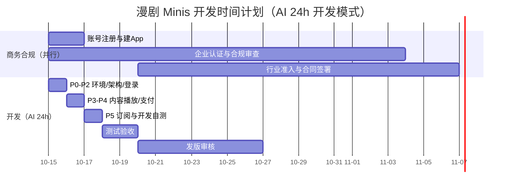

# 开发时间计划

## 总体周期

- **开发模式**：AI 24 小时持续开发，开发 3 天 + 测试 2 天
- **发版审核**：3~7 天（平台侧，不可控）
- **上线目标**：2026-10-27 左右（**实际取决于合规审查完成时间**）
- **关键路径**：合规审查（2~4 周，商务侧）→ 发版审核（平台侧）
- 上线日期 = max(开发测试完成 10-20，合规审查完成) + 审核周期

## 甘特图

## 阶段明细

| 阶段 | 内容 | 工期 | 日期 | 交付物 | 依赖 |
| --- | --- | --- | --- | --- | --- |
| P0~P2（第 1 天） | 环境准备 + 基础架构 + 登录授权闭环 | 1 天 | 10-15 | 调试环境可用、工程骨架、登录授权联调通过 | 无 |
| P3~P4（第 2 天） | 内容展示 + 播放 + 端内支付（Webhook 验签发货） | 1 天 | 10-16 | 免费集完整链路 + 付费解锁全链路 | P2 + 企业认证 |
| P5（第 3 天） | 订阅 + 权益校验 + 开发自测收尾 | 1 天 | 10-17 | 订阅开通 + 权益校验 + 生命周期回调 | P4 |
| 测试验收 | 全链路测试、真机验证、测试用例 | 2 天 | 10-18 ~ 10-19 | 测试通过报告 | P5 |
| 发版审核 | `minis build` → 提交审核 → 驳回修复 | 3~7 天 | 10-20 ~ 10-26 | 审核通过 | 测试通过 + 合规完成 |

## 里程碑

| 里程碑 | 目标日期 | 达成标准 |
| --- | --- | --- |
| M1 立项与文档 | 2026-10-14 | 文档站点上线，排期明确 |
| M2 合规材料提交 | 2026-10-20 | 企业认证 + 合规材料 + 行业准入提交 |
| M3 环境跑通 | 2026-10-15 | SDK init + 内测包扫码调试成功 |
| M4 登录闭环 | 2026-10-15 | 静默登录 + 显示授权联调通过 |
| M5 可看剧 | 2026-10-16 | 内容展示 + 播放 + 免费集完整链路 |
| M6 可付费 | 2026-10-16 | 支付全链路（含 Webhook 验签发货） |
| M7 可订阅 | 2026-10-17 | 订阅开通 + 权益校验 + 生命周期回调 |
| M8 测试验收 | 2026-10-19 | 全链路测试通过 |
| M9 提审 | 2026-10-20 | minis build + 提交审核 |
| M10 上线 | 2026-10-27 | 审核通过，正式上线（随合规完成日浮动） |

## 关键风险与建议

1. **合规审查是唯一关键路径**：开发测试 5 天即可完成，但上线必须等合规审查（2~4 周）通过，商务侧须第一天启动、10-20 前完成材料提交
2. **支付能力开通依赖企业认证**：IAP 开通、Webhook 配置必须在认证完成后，商务侧需要及时同步平台配置
3. **调试仅安卓**：提前准备 M/T 内测包、对应地区测试账号（账号地区 / 商店地区 / 代理地区一致）；iOS 只能上传平台看效果
4. **支付闭环以 Webhook 为准**：前端回调只是体验，后端必须验签 + 幂等（`trade_order_id` 唯一索引）+ 防重复发货
5. **媒资方案**：优先平台媒资库播放器，避免自建转码成本
6. **订阅商品能力范围**：与 TikTok 商务确认漫剧类目对订阅商品的支持范围与结算口径
