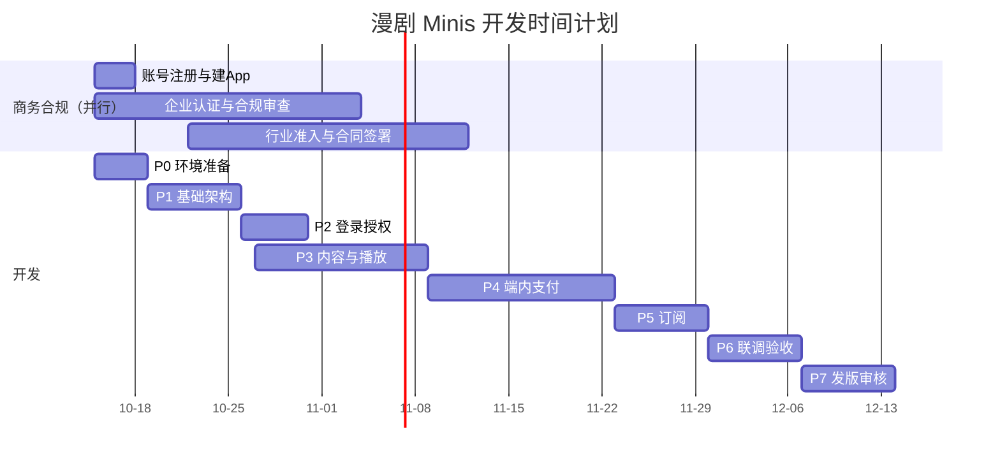

# 开发时间计划

## 总体周期

- **纯开发周期**：约 6 周
- **含商务合规与发版审核**：约 7~9 周（2026-10-15 启动，目标 2026-12-14 上线）
- **假设人力**：前端 2 + 后端 2 + 测试 1 + 商务 / 运营 1
- **关键路径**：合规审查（不可控）→ 支付接入 → 发版审核

## 甘特图

## 阶段明细

| 阶段 | 内容 | 工期 | 起止 | 交付物 | 依赖 |
| --- | --- | --- | --- | --- | --- |
| P0 环境准备 | 注册 / 建 App、安装 minis-cli、内测包、SDK init 跑通 | 2~3 天 | 10-15 ~ 10-18 | 调试环境可用 + SDK 初始化成功 | 无 |
| P1 基础架构 | 前端工程 + 后端服务框架 + DB/Redis + CI | 1 周 | 10-19 ~ 10-25 | 工程骨架、部署流水线 | P0 |
| P2 登录授权 | login + authorize 前后端闭环、用户中心 | 3~4 天 | 10-26 ~ 10-30 | 登录授权联调通过 | P1 |
| P3 内容与播放 | 剧集 API、详情页、播放页、媒资、CMS 最小可用 | 1~1.5 周 | 10-27 ~ 11-08 | 免费集可看完整链路 | P1 |
| P4 端内支付 | IAP 开通、预支付订单、pay、Webhook 验签 + 幂等发货 | 1~1.5 周 | 11-09 ~ 11-22 | 付费解锁全链路（含发货） | P2 + 企业认证 |
| P5 订阅 | 订阅商品、subscribe、权益校验、续费 / 退订回调 | 1 周 | 11-23 ~ 11-29 | 订阅开通与权益生效 | P4 |
| P6 联调验收 | 全链路联调、真机测试、测试用例、性能检查 | 1 周 | 11-30 ~ 12-06 | 验收报告、测试通过 | P5 |
| P7 发版审核 | 构建打包、提交审核、驳回修复 | 3~7 天 | 12-07 ~ 12-13 | 审核通过 | P6 + 合规完成 |

## 里程碑

| 里程碑 | 目标日期 | 达成标准 |
| --- | --- | --- |
| M1 立项与文档 | 2026-10-15 | 文档站点上线，团队分工明确 |
| M2 合规材料提交 | 2026-10-20 | 企业认证 + 合规材料 + 行业准入提交 |
| M3 环境跑通 | 2026-10-18 | SDK init + 安卓内测包扫码调试成功 |
| M4 登录闭环 | 2026-10-30 | 静默登录 + 显示授权联调通过 |
| M5 可看剧 | 2026-11-08 | 内容展示 + 播放 + 免费集完整链路 |
| M6 可付费 | 2026-11-22 | 支付全链路（含 Webhook 验签发货） |
| M7 可订阅 | 2026-11-29 | 订阅开通 + 权益校验 + 生命周期回调 |
| M8 提审 | 2026-12-07 | minis build + 提交审核 |
| M9 上线 | 2026-12-14 | 审核通过，正式上线 |

## 关键风险与建议

1. **合规审查是真正的关键路径**：商务侧与开发第一天并行启动，不要等开发完成再提审
2. **支付闭环以 Webhook 为准**：前端回调只是体验，后端必须验签 + 幂等（`trade_order_id` 唯一索引）+ 防重复发货
3. **调试仅安卓**：提前准备 M/T 内测包、对应地区测试账号（账号地区 / 商店地区 / 代理地区一致）；iOS 只能上传平台看效果
4. **媒资方案**：优先平台媒资库播放器，避免自建转码成本
5. **订阅商品能力范围**：与 TikTok 商务确认漫剧类目对订阅商品的支持范围与结算口径
6. **多语言与地区扩展**：先跑单一地区（US 或 JP），App 配置预留多语言
