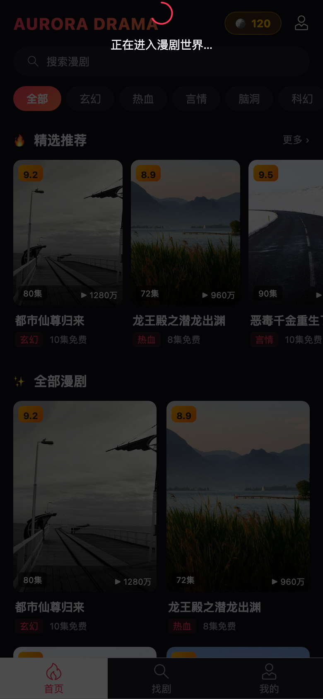
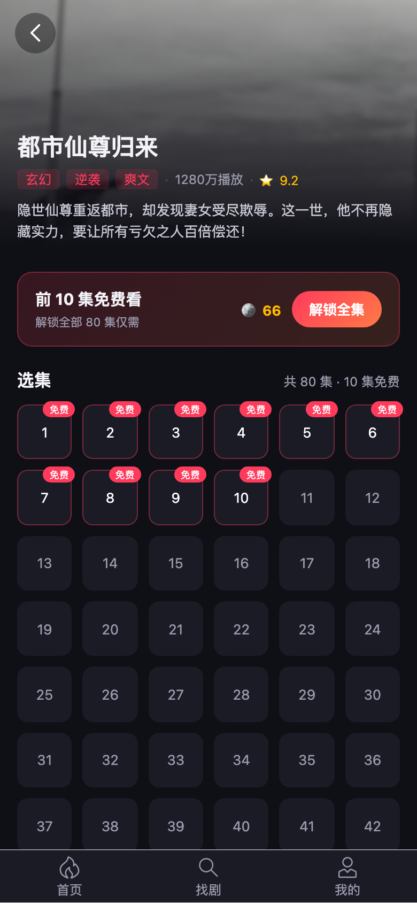
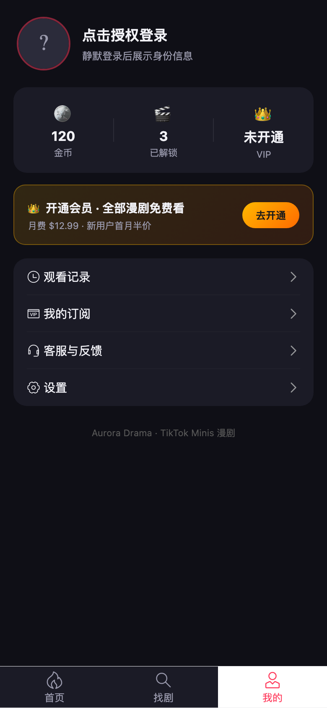
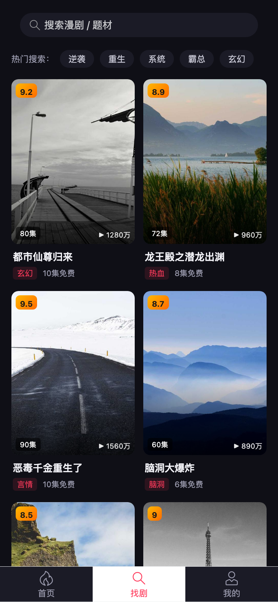

T 日正式启动开发：TikTok 开发者平台账号验证通过，Minis 前端核心页面全部完成。

<!-- more -->

## 平台账号状态（重要）

- 登录 `developers.tiktok.com` 成功，组织 **UYING MEDIA LIMITED** 下已有 3 个 App
- **Aurora Drama**（App ID `7670022867891177493`）为 Mini Drama 类型应用，状态 Not released
- Client Key：`mnp696ef4kyeebk7`（已写入工程）
- 启动清单 0/6：企业认证 / 行业资格 / 发布审批 / 媒资激活 / 基本信息 / 开发调试
- 开发调试**不依赖**上述商务步骤，可以先行完成

## 功能描述

1. **首页剧单**：Logo + 金币余额、搜索条、分类标签（玄幻/热血/言情/脑洞/科幻）、精选横向滑动、双列瀑布流
2. **剧集详情页**：头图 + 标签 + 简介、付费横幅（前 N 集免费/解锁全集）、选集宫格（免费集标红）、单集解锁支付浮层
3. **播放页**：竖屏沉浸式、播放/暂停、进度条、自动续播、底部选集横滑（付费集带锁标）
4. **个人中心**：静默登录 + 显示授权、金币/已解锁/VIP 资产卡、订阅横幅、VIP 订阅浮层
5. **搜索页**：关键词搜索 + 热门标签
6. **SDK 封装**：`TTMinis` login/authorize/pay/subscribe 统一封装，浏览器环境自动走 mock，真机环境直连官方 JSAPI

## 界面展示

### 首页剧单

### 剧集详情

### 播放页

### 个人中心

### 搜索页

## 下一步计划

- 工程构建验证 + 本地预览跑通
- 安装 minis-cli，真机（内测包）调试
- 后端服务（登录换 token / 订单 / Webhook）搭建
- 媒资上传与平台播放器接入
