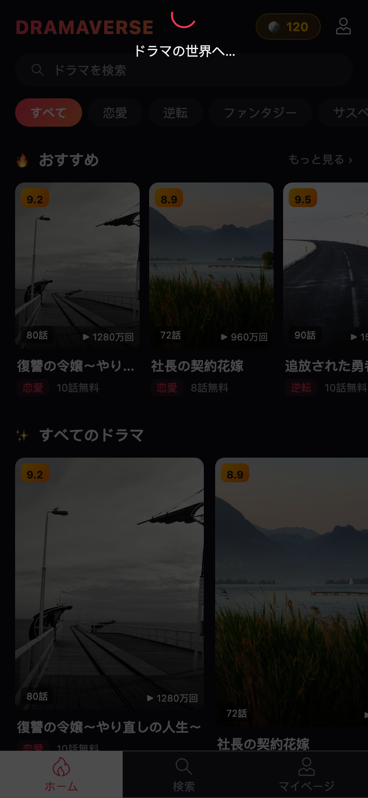
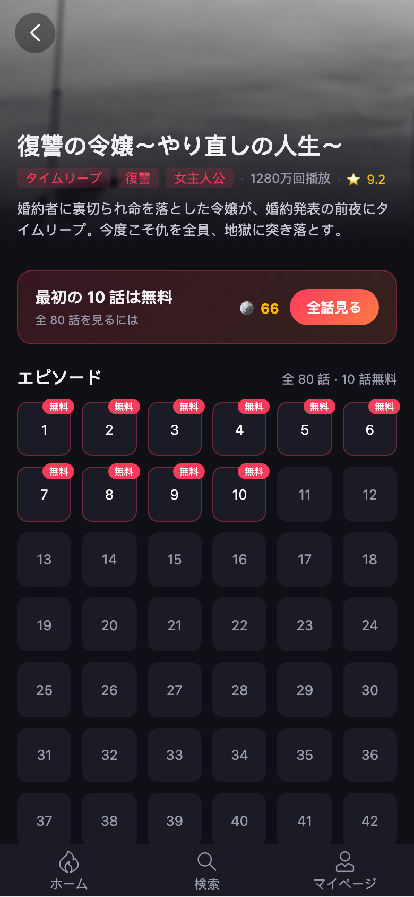
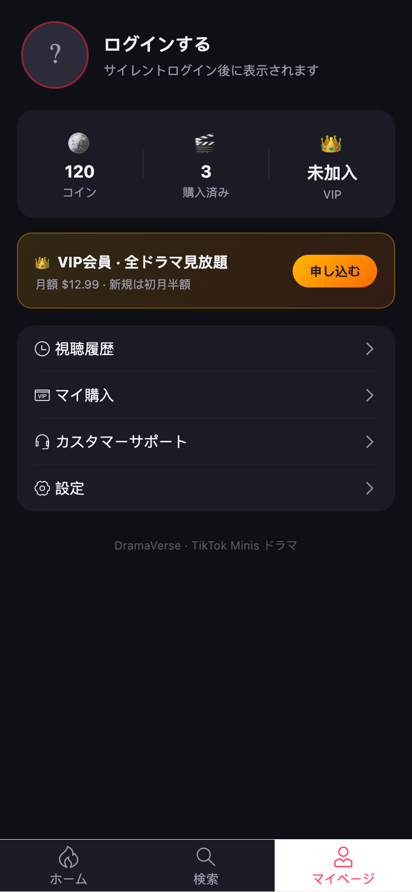

弃用 Aurora Drama，新建 **DramaVerseJP**（App ID `7696338880869500980`），定位日本市场，前端已完成日语化并成功上传平台。

<!-- more -->

## 平台进展

| 项目 | 值 |
| --- | --- |
| App 名 | DramaVerseJP |
| App ID | `7696338880869500980` |
| Client Key | `mnxhskb12ahzifub` |
| 代码资产 | Asset `7696329454767081479`，Version 1（code linting 中） |
| 预览 | 待 lint 完成后创建 Preview 版本（最多 30 个） |

## 提审前置条件（当前阻塞项）

1. Basic information approval —— 需补充 App 图标（1024×1024）、描述、Terms/Privacy URL
2. Industry verification approval —— 行业资质审核
3. Monetization feature —— 需开通短剧变现功能

## 功能描述

- **日语化**：首页 / 详情 / 播放 / 个人中心 / 搜索全部文案切换为日语
- **日本题材剧单**：復讐の令嬢 / 社長の契約花嫁 / 追放された勇者 / ゾンビアポカリプス / 異世界転生 等 8 部 mock 剧
- **官方打包规范**：`minis.config.json` + `minis.manifest.json`（`ttdx minis build:after` 生成）+ SDK 首脚本 init + 回调风格 login（`authResponse.code`）
- **打包命令**：`npm run build:minis` 一键构建 + 生成 manifest

## 界面展示

## 下一步

- 等 lint 完成 → 创建 Preview 版本 → 生成二维码（T 包扫码）
- 补齐 Basic information（图标 / 描述 / Terms / Privacy）
- 企业认证与行业资质（商务侧）
- 媒资激活（BytePlus）+ 后端登录/支付/Webhook
