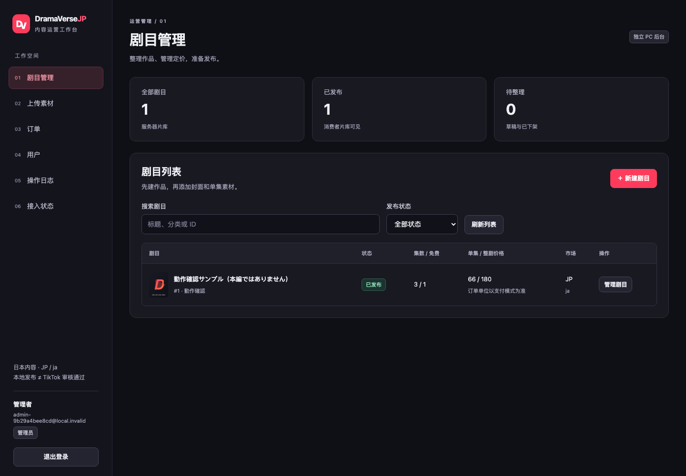
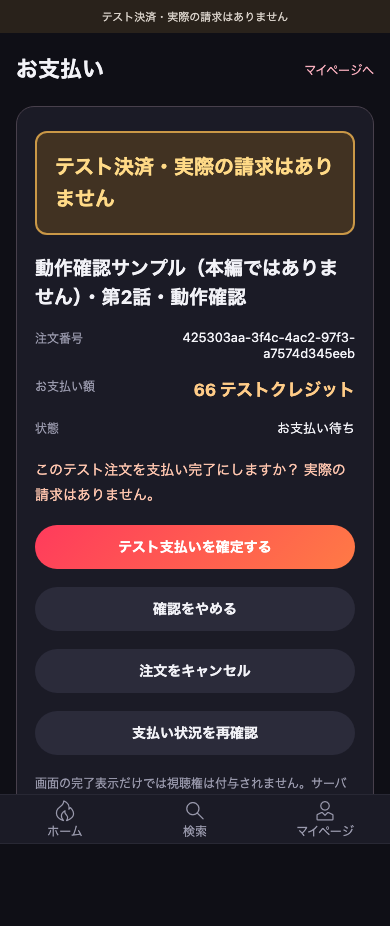
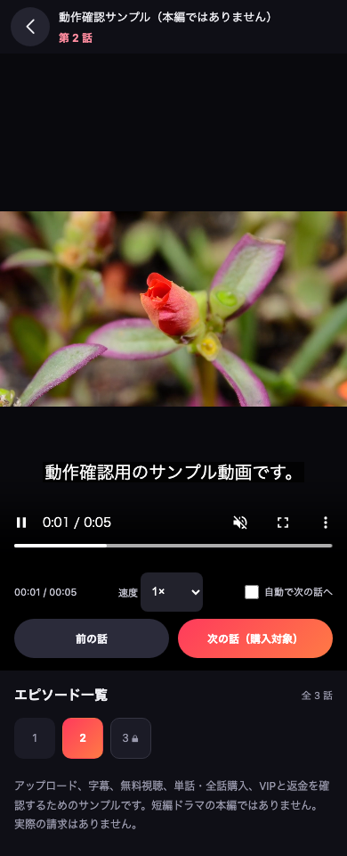

**本轮从前端样例推进到了可运行的本地前后台服务。** 运营可以上传和管理内容；普通用户可以注册、试看、生成订单、确认明确标识的测试支付、取得服务器权益并观看。数据库和文件会保留，不会因为刷新网页变回假数据。

<!-- more -->

**完成的是本地业务开发与验证，不是 TikTok 上线。** 业务代码提交：`db8be2f`。本轮文档和交付包仅在本地生成，未推送公开网站。

使用入口和完整步骤见 [前后台本地使用手册](/guide/local-fullstack)。整体上线分工见 [开发交付清单](/guide/developer-delivery)。004 的 Basic Information 资料核查仍保留，不能把这次代码实现当成平台提审。

## 已实现范围

| 模块 | 实际能力 |
| --- | --- |
| 业务服务 | Node.js、SQLite、私有上传、角色检查、同源会话、操作记录 |
| 管理网页 | 登录、新剧、封面上传、多集队列、字幕关联、定价、版本冲突、发布 / 下架、订单 / 用户 / 日志 |
| 用户网页 | 动态片库、日文搜索、真实账户、免费试看、已购播放、收藏、历史、续看 |
| 商业业务 | 服务器定价、订单去重、单集 / 整剧 / 测试 VIP、退款撤权、跨用户隔离 |
| 付款恢复 | 页面没收到已入库的付款结果时重新查询，避免重复发权 |
| 平台适配 | 真实换码、令牌加密、Beans 建单和回调验签边界；官方播放器调用；没有声称真机 / 真钱测试通过 |

## 本轮发现并处理的问题

- 新增服务模式后，旧离线单测仍按默认环境运行，产生 32 项失败：将旧测试明确固定为离线模式，保留原断言；服务模式单独测试。
- 开发页使用 5173 / 5174，原服务只允许 5310 来源，导致写请求 403：仅本地默认加入开发来源，显式名单仍优先，生产不自动放行开发端口。
- 新增整剧和 VIP 浏览器测试最初用了错误的管理导航名称，已按真实 DOM 修正定位，再跑整个业务路径。
- 本地与生产数据库分别存放并记录环境；切错库会拒绝启动，旧本地会话、播放入口和沙盒权益不能用于生产。
- 真实订单取消、过期或预建单结果未知时保留原单，不自动建替代订单；迟到回执仍能发权。结算页显示服务器提示并继续查询。
- 平台部分追回通知先验签和匹配，按每次投递持久化；后台可分页查原始金额，不丢通知、不盲目累加、不冒充全额退款。
- 全量浏览器测试发现文件注入早于上传入口启用的竞态：先等待真实可操作状态，再注入文件，并检查队列，不通过增加固定等待时间掩盖。
- 独立审阅发现“详情已不可播放仍能建单”：提取共用内容判断，新建单与本地付款同时检查语言、地区、平台状态和可用视频；已验签的真实迟到付款不因后来下架而丢失。
- 双浏览器全量用例的反复种子登录触发真实限流：复用测试管理员的已认证会话，保留真实页面登录验证，不提高或禁用服务器限流。

## 验证记录

**最终 `npm run test:all` 退出码 0：331 项通过，0 失败、0 跳过。** 所有测试均在本机或隔离临时库执行，没有使用用户的真实 TikTok 付款。

| 验证 | 结果 | 说明 |
| --- | ---: | --- |
| 前端单元测试 | 116 / 116 | 离线与真实服务模式分别验证 |
| 服务端测试 | 139 / 139 | 账户、上传、内容、订单、退款、环境隔离与平台接口边界 |
| 独立管理页测试 | 18 / 18 | 含真实临时后端；默认不跳过该用例 |
| 离线浏览器测试 | 30 / 30 | Chromium / WebKit |
| 真实全栈浏览器 | 10 / 10 | 管理员与观众、真实文件和数据库 |
| TikTok SDK 替身浏览器 | 18 / 18 | 两浏览器，**不是 TikTok 真机** |
| 上传到退款主流程重复运行 | 6 / 6 | 两浏览器各 3 次，不计入上方 331 |
| 干净目录 `npm ci` + 全栈构建 + 单测 | 通过 | 未使用工作区的 node_modules、数据库或凭据 |
| 仅运行依赖安装后的独立运行包 | 通过 | 初始空片库、管理员登录、用户注册与重启 |
| 本机真实服务进程重启 | 通过 | 同一 Cookie 恢复用户，原订单仍已付，历史及付费播放可用 |
| 官方 CLI 构建与复查 | 通过 | 24 个文件，无后台、数据库或测试 MP4；未上传 |
| 文档构建与依赖审计 | 通过 | 当次审计 0 漏洞 |

环境：Node.js 22.23.2；另验证 Node.js 22.13.1 的 SQLite 和金额原文解析能力。浏览器使用 Playwright，用户页 390×844、管理页 1440×1000，并检查管理页窄屏。最终管理页截图检查无空白、无框架错误遮罩、控制台错误和未捕获异常均为空。

Node SQLite 仍有实验功能提示；CLI 的部分间接依赖仍有弃用警告。外部模型监督程序因认证 401 未完成，**未计为通过**；独立代码审阅发现的问题均已补真实回归。新增 CI 工作流只配置了检查，未宣称远程 CI 已运行。

详细输出、此前失败记录与脱敏结果在本地 `artifacts/fullstack-20261014/validation/`。`final-summary.json` 标明最终通过结果；保留此前失败日志以便追溯，不以旧失败或部分测试代替最终结论。

验收主路径：

1. 管理页上传封面与多集 MP4，创建单集并发布。
2. 普通用户在页面注册，选择付费集、服务端建单，二次确认无真钱支付。
3. 服务端发权后播放；刷新、退出重登、服务重启后订单与权益仍保留。
4. 第二个用户不能读第一人的订单、播放凭证、收藏和历史。
5. 整剧与 VIP 页面购买、取消确认、后台页面退款，检查相关内容恢复锁定。
6. 实际视频播放事件记录进度；跨设备登录可继续查看服务器收藏与历史。
7. 修改密码后其他设备会话撤销；付款响应丢失后重新查单恢复。

## 实际界面

以下均为本地真实运行截图；已上传内容是明确标识的功能验证样例，不是商业短剧本片。

### 管理页

### 用户测试付款

### 已解锁播放与字幕

## 本轮不代表什么

没有开通商户或订阅商品，没有向 BytePlus 上传商业内容，没有改变主体、App ID、美国项目，没有提交审核、发布网站或进行真实扣费。

本地 Sandbox VIP 不是生产自动续订。真实订阅、媒资状态同步、Mini 跨源部署和端内真机验证仍需开发方配合平台资料继续完成，不能写成“只差运营上传”。
