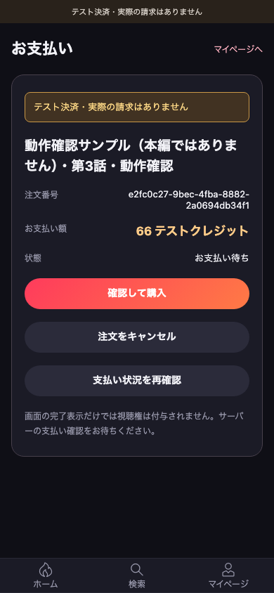
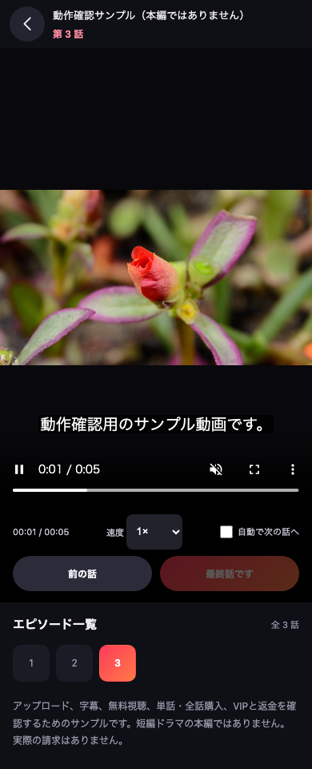

本轮响应“为什么测试版和上线版操作不同，继续完成”：**同一套产品流程，只在外部服务、环境数据与明确标识上区分。**

<!-- more -->

业务提交：`acb6e90`。完成的是本轮同流程改造与本机验证，不是整个应用的正式上线。没有推送公开文档或提交平台审核。

## 实现内容

- 测试付款不再要求先进入再确认；订单页一次明确购买，渠道调用后统一查询业务订单及对应用户权益。
- 付款响应丢失、权益稍后到账时自动安全重查；不因 SDK 回调就提前发权。
- 预发布与正式共用平台登录、内容可见性与播放器条件。预发布只收明确测试回执，正式只收明确正式回执。
- 管理员页面清楚区分本地、预发布和正式；订单新增平台状态核对，不把平台 `SUCCESS` 显示成业务已付。
- 平台建单前先进行官方金额检查；无法确认时不发起交易创建。
- 部署可精确配置跨域及 Secure/SameSite Cookie，保留现有来源、会话、上传及支付权限检查。
- 独立验收启动器使用同一份构建和临时隔离数据库，只有外部 TikTok 与解码器用替身；登录、订单、验签、发权及退款均走真实业务 HTTP。

完整配置和区别见 [测试与正式共用流程](/guide/environment-parity)。本地上传使用方式仍见[前后台手册](/guide/local-fullstack)。

## 验证与交付

最终 `npm run test:all` **退出码 0，525 项通过，0 失败、0 跳过**。全部记录在本机 `artifacts/parity-20261015/validation/`，此前失败和修复后的记录分开保存。

| 分类 | 结果 | 证明范围 |
| --- | ---: | --- |
| 前端单测 | 126 / 126 | 支付渠道边界、身份与前端状态 |
| 服务端 | 276 / 276 | 预发布、回执环境、金额校验、主动查单、CORS和既有业务 |
| 管理页 | 19 / 19 | 预发布标识、平台核对与既有上传退款 |
| 离线预览浏览器 | 30 / 30 | Chromium / WebKit |
| 用户全栈与SDK边界浏览器 | 42 / 42 | 10 条真实本地业务，32 条明确标注的 SDK 替身测试 |
| 离线测试工具自检 | 2 / 2 | 端口隔离及拒绝未允许外网 |
| 三环境同构建跨层浏览器 | 24 / 24 | 三个独立库，真实身份换码、订单、HTTP验签、发权与退款；外部平台为替身 |
| TLS 浏览器策略检查 | 6 / 6 | 同站跨源通过；跨站记录真实允许或阻止结果 |

**TLS 的 6 项通过不等于所有浏览器跨站登录都通过。** 本次 Chromium 跨站建立了会话，WebKit 未保存第三方 Cookie，后续仍为未登录；该限制已明确记录，未关闭安全保护绕过。详情见[环境配置说明](/guide/environment-parity#本机真实-tls-浏览器观察)。

其他实际检查：

- 干净目录重新 `npm ci`，全栈构建与 126 项前端单测通过；当次依赖审计 0 漏洞。
- 预发布／正式的官方 CLI 构建和复查通过；在相同空 API 配置下，两个候选包内逐文件字节相同。**它们没有配置真实业务 API，只能作为结构候选，不能直接上线。**
- 独立运行包仅安装运行依赖后能启动、注册、重启恢复账号；同一包的预发布启动配置检查不创建数据库。
- 主工作区服务已更新，旧用户与已付款订单保留，旧付费集仍能取得授权并以 Range 读取。
- 实际用户页面测试：查看价格 → 一次确认 → 查单／核实权益 → 自动回播放页 → 视频时间真实推进，管理员看到同一已付订单。未捕获浏览器异常为 0。

### 修复中保留的真实问题记录

- 原测试付款有额外确认，已移除而不减少后台验证。
- 原正式账号页展示本地邮箱登录，实际后端会拒绝；改为按环境显示可用登录方式。
- 独立审阅发现短暂断网恢复同账号时被误判换号，以及等待权益时手动返回会停止轮询；新增回归先失败，再修复，双浏览器 6 条复测通过，真正换号仍被阻止。
- 外部模型监督程序因认证 401 不可用，未计为通过；独立审阅、实际测试与输出另有记录。
- Node SQLite 实验提示、CLI 间接依赖弃用提示保留，不隐瞒。

### 实际更新后的界面

## 不夸大的边界

- staging 设置不会让 TikTok 自动开启免扣款测试，仍需平台真实权限。
- 离线正式路径的外部 TikTok 服务是替身，不代表官方沙箱或手机真机测试。
- 主动查单没有完整金额／退款／测试标记，不能单独当发货凭证。
- 自动订阅、媒资审核同步、真实撤单及端内部署验收仍有工作。
- 本轮不修改美国应用、不上传平台、不公开部署、不执行真实扣款。
