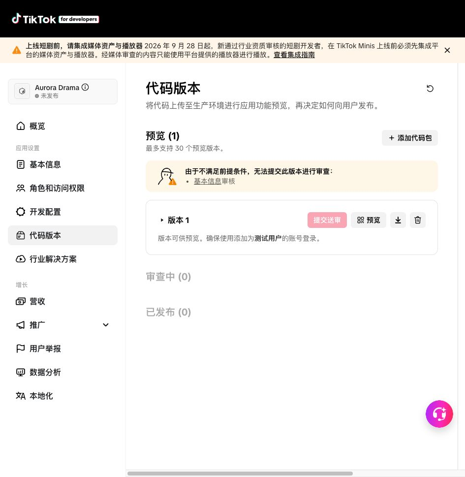

用户已明确要求将代码上传到 **Aurora Drama（App ID `7670022867891177493`）**，当前日本首发，后续扩展韩国和东南亚。

<!-- more -->

## 本轮确认与变更

- 通过已登录后台确认 Aurora 应用，公开 Client Key 为 `mnp696ef4kyeebk7`，不是旧 DramaVerseJP 的编号。
- 上传前版本页显示“暂无代码包”；不会覆盖既有线上版本。
- `minis.config.json` 作为 Client Key 的唯一构建来源，HTML 初始化从它注入，避免改应用只改一处。
- 标题与可见品牌对齐 Aurora，日文、日本片库与既有用户数据协议保持不变。
- 环境配置样例同步 Aurora 公共标识，Client Secret 仍为空，需由管理员安全配置。
- 当前 JP／ja 不变，没有启用韩国或东南亚地区。

## 上传与扫描结果

**已上传并点击“添加代码包”，随后刷新后台确认记录仍在。**

| 项目 | 本轮实际结果 |
| --- | --- |
| 应用 | Aurora Drama，`7670022867891177493` |
| 代码提交 | `3e4aa6e` |
| 上传文件 | `aurora-drama-jp-20261015.zip` |
| 平台版本号 | **1** |
| 版本状态 | **版本可供预览**，预览版本数 1 |
| 审查中／已发布 | **0／0** |
| 提交送审按钮 | 不可用；页面明确提示缺少**基本信息审核** |
| 本地包大小 | 139,786 字节；解压后 332,587 字节，共 24 个文件 |
| 本地上传包 SHA-256 | `cc9afe5241e8f6fd651d09d2611b570356749c2a79bd1f9f1bcf5da3b1f530ea` |

页面没有单独展示“安全扫描通过”的独立结果，因此本记录只确认平台给出的**可预览状态**，不把它扩写成业务审核通过。

上传备注也明确写入：日本首发、当前提交与本地验证数、API／媒资／真实支付未完成、未提审发布，韩国和东南亚后续开放。

### 上传前验证

新增应用绑定测试先复现旧 Key／重复初始化来源问题，再修复。最终 `npm run test:all` **536 项通过，0 失败、0 跳过**：

- 前端单测 137；服务端 276；后台网页 19。
- 离线浏览器 30；用户全栈及 SDK 边界 42；三环境跨层 24。
- 测试工具自检 2；TLS 浏览器策略检查 6。

TLS 检查仍如实记录 WebKit 跨站 Cookie 被阻止，不将检查通过说成所有跨站登录可用。SDK／外部平台替身不是 TikTok 真机。官方 CLI 构建与复查通过；包中不含后台服务、数据库、测试片源或任何秘密配置。

### 平台实际页面

## 上线前仍需完成

Aurora 的基本资料、实际业务 API 与域名、媒资、支付和真机联调尚未完成。**平台允许生成预览版本，不代表这个包现在就能连接上线后台、播放正式内容或收费。** 本轮没有设置实际业务 API，没有勾选／提交韩国或东南亚市场，没有提审或发布。

项目目标、后续地区扩展与分工见 [Aurora 日本首发说明](/guide/aurora-launch)。此前 004、007、008、009 保留为原时间点的历史记录，不把旧应用的资料保存状态套到 Aurora。
