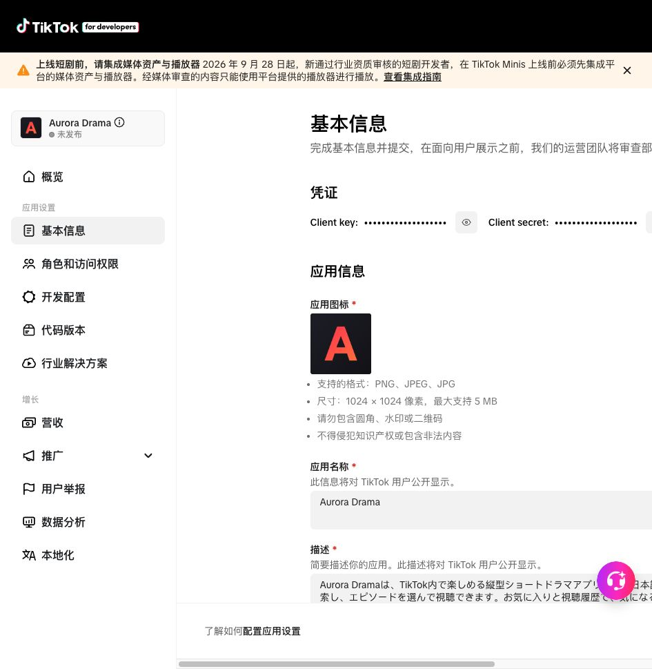

本次直接完成可以确认的资料，不再因缺少 Apple Team ID 而把其他字段都留空。**已保存不等于已提审：没有调用审核提交接口，也没有发布应用。**

<!-- more -->

## 当前目标

- 应用：**Aurora Drama**，`7670022867891177493`。
- 主体：`7669964115334611988`（11988）。
- 本次地区：仅日本 `JP`，没有开启韩国或东南亚。
- 用户已确认主体流程完成；本记录只描述 Aurora 这款应用的基本信息。

## 服务端已保存，并经刷新核实

| 字段 | 实际状态 |
| --- | --- |
| 名称 | `mini_drama_name.staging_value = Aurora Drama` |
| 图标 | 上传并保存 1024×1024 RGB PNG；`mini_drama_icon_uri.staging_value` 非空 |
| 日文描述 | `description.staging_value` 已保存，122 字 |
| 服务条款 | `terms_of_service.live_value` 为既有 HTTPS 条款地址 |
| 隐私政策 | `privacy_policy.live_value` 为既有 HTTPS 隐私地址 |
| 发布地区 | `region.live_value = JP` |
| 最低 SDK | `min_sdk_version.live_value = 0.4.1` |

`live_value` 是接口字段名，不表示整款应用已经上线。名称、图标、描述仍是未送审资料。

图标沿用应用现有深色背景和红橙配色，使用 Aurora 的 A 标识，未继续使用印有旧品牌的图片。源文件与上传文件：

```text
/Users/xuan/Desktop/cursor/tiktok/docs/.vitepress/public/aurora-icon.svg
/Users/xuan/Desktop/cursor/tiktok/docs/.vitepress/public/aurora-icon.png
```

描述避免使用目前尚未兑现的“每日更新、VIP 已可订阅、全部内容畅看”等承诺：

```text
Aurora Dramaは、TikTok内で楽しめる縦型ショートドラマアプリです。日本語の作品を検索し、エピソードを選んで視聴できます。お気に入りと視聴履歴で、気になる作品や続きのエピソードを見つけられます。無料エピソードからお楽しみください。
```



## 尚未完成的真实资料和声明

| 项目 | 当前证据 / 下一步 |
| --- | --- |
| Apple Team ID | 服务端仍为空；正常保存按钮明确报“输入你的 Apple 团队 ID”。需所属 Apple 开发者团队的真实编号，不是联系邮箱 |
| 联系邮箱 | 页面填入用户先前提供的 `vortex528@gmail.com`，已点击一次发送验证码，页面出现重新发送倒计时和验证码输入框 |
| 邮箱验证 | 仍未验证；此前另一个 App 的已验证状态不能当作 Aurora 已验证。等待用户提供当次验证码，不写假的 `email_verified` 或验证票据 |
| 版权内容自查 | 正常保存报“需进行版权内容自查”。弹窗涉及代码、图像、视频、音频、第三方接口及 AI 内容等权利确认；不能把旧 App 的状态直接当成新 App 已确认 |
| 日本地区合规 | 正常保存报“勾选此框，确认符合选定发布地区的当地法律”。由负责人确认后再提交声明，未擅自勾选 |

网址管理权限框已按用户提供的项目网站勾选；该框是页面确认项，刷新后可能需要重新勾选。

**邮箱验证码发送后，不要刷新当前基本信息页，否则可能丢失本轮验证流程。** 后续使用当前已登录 tab 20 的验证码输入框；过期时再按页面操作重新发送，不连续重复发码。

## 已修正文案，但公开网页尚未更新

本轮访问公开条款页，确认其仍将服务称为 DramaVerse，并写成 VIP 已经提供自动续费。这与 Aurora 当前状态不一致。

本地已修改：

- `docs/terms.md`：名称改为 Aurora Drama，保留旧名说明；购买采用提供后以确认页为准的表述，VIP 明确为准备中、不接受订阅或产生订阅扣款。
- `docs/privacy.md`：服务名称改为 Aurora Drama，保留旧名说明。
- 公司名称、既有联系方式及其余法律条款没有任意替换。

**这些只是本地文案修订，不是法律合规审核结论；未推送 GitHub、未部署公开网站。** 提审前需确认文案并发布，重新打开两个公开 URL，核实已经显示 Aurora 的正确内容。已保存 URL 不代表公开正文已改好。

## 保存与验证过程

1. 读取 Aurora 的现有字段，确认除名称外尚为空。
2. 页面填写已知内容。
3. 使用此前从官方页面确认的 `fields` 保存格式，只保存已有真实资料，不提交审核。
4. 把未验证邮箱一起保存时，接口返回 HTTP 400 `Invalid parameter`；单独保存该邮箱也返回相同错误。未通过伪造验证字段解决。
5. 去掉待验证邮箱后，日文描述、条款／隐私 URL、日本地区和 SDK 保存成功，随后 GET 读到对应实际值。
6. 经页面上传新图标，再保存该图片的真实引用；GET 和刷新后的页面均确认图标保留。
7. 按正常 Save 操作复核，页面明确显示 Team ID、版权自查和日本合规三项错误；未发送提审请求。
8. 通过页面发送一次邮箱验证码，等待用户继续。

本轮已保存证据位于本机：

```text
/Users/xuan/Desktop/cursor/tiktok/artifacts/aurora-basic-info-20261015/before.json
/Users/xuan/Desktop/cursor/tiktok/artifacts/aurora-basic-info-20261015/after-fields-save.json
/Users/xuan/Desktop/cursor/tiktok/artifacts/aurora-basic-info-20261015/after-icon-save.json
/Users/xuan/Desktop/cursor/tiktok/artifacts/aurora-basic-info-20261015/remaining-verification.png
```

证据只保留业务字段，不包含 Client Secret、Cookie、登录态或邮箱验证码。原登录态文件继续留在本机，不进入 Git。

## 下一步

1. 获取正确的 Apple Team ID。
2. 在当前表单完成邮箱验证码验证，再保存并重新查询邮箱状态。
3. 负责人确认版权与日本地区合规声明，确认公开条款修订内容。
4. 发布并核实条款／隐私网页；完成最后正常保存后，再提交 Basic Information 审核。
5. 记录平台实际审核状态，不把接口 HTTP 200、资料保存、代码可预览混同为审核通过。

本轮文档构建通过，图标尺寸及可见效果已检查。外部修改监督工具返回认证 401，**未计入通过**。本轮不涉及业务代码修改，不以之前的业务测试代替平台审核。
