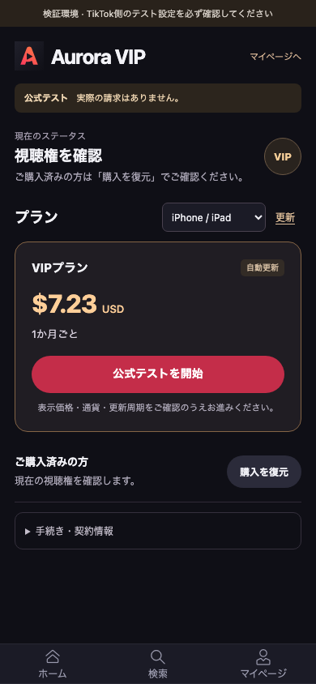
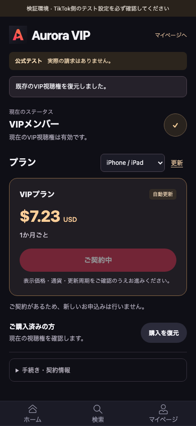

**目标仍是 Aurora Drama（`7670022867891177493`），日本首发。** 本轮继续完成开发，不把“补卡”当成唯一剩余项，也不把无真钱测试当作正式订阅已上线。

**本阶段已经验证：套餐与原操作恢复、官方测试入口、当前会员访问，以及这些功能与原有购买／播放流程的衔接。** 首次付款通知核销、每期订阅流水和完整退款处理还在继续，真实部署、真机及平台审核未完成。

<!-- more -->

## 1. 用户现在走同一份实际前后台代码

- 个人页和付费剧集页进入 **Aurora VIP**，不再拿本地固定 Beans 价格冒充正式订阅价格。
- 套餐价格、币种与周期来自服务端平台适配器；后台保存原始价格字符串。界面仅安全去掉尾部零，不换币种、不用浮点计算重定价。
- 在明确启用的官方测试环境，一次点击完成保存操作、最新价格／合同复核、领取一次性 SDK 指令和启动流程。
- 重开页面只读原记录；未知结果不新建订阅，不把已领取过的 SDK 指令再发一遍。
- 已有会员可恢复当前观看资格。新订单是否已付款，仍须匹配该笔订单的有效通知，不能拿旧订单或 SDK 成功作证。

配置和操作见[订阅套餐、官方测试与已有会员恢复](/guide/subscription-workflow)。

## 2. 当前会员访问不是伪造付款

后端使用用户已授权给本应用的身份查询平台：

- 只认可本应用允许的档位和明确的对应环境。
- 取消续费不直接等同会员失效；以平台当前权益标志为依据。
- 每次受保护播放现场刷新；免费集及已购单集／整剧不被无关的会员查询故障阻断。
- 查询失败是“未核实”，不是“未购买”。新的单次购买也会先检查会员，避免重复收费。
- 同一订阅的档位、环境或权益信息矛盾时不放行；不同订阅中的真实有效资格和一致重复记录不受误伤。
- 新通知使旧观察过期，迟到查询不能覆盖更新的观察；30 秒新鲜度不显示成会员到期日。

没有据此生成假的已付订单、退款金额或“固定加 30 天”的正式会员期间。

## 3. 手机上不再先翻两屏说明

查看实际 390px 截图后，已将价格卡上沿从约 **1107.5px** 调整到约 **298.4px**：

- 品牌、当前会员摘要、价格与主按钮优先显示。
- 测试提示保留为一条清楚的短横幅。
- 恢复购买紧凑显示；交易 ID、时间及技术说明放到可展开详情。
- 已识别手机类型且已登录时自动读取一次套餐；未知端末仍明确选择。
- 只对本次新建操作自动衔接 SDK；找回的旧操作不会自动再次打开。

下面是 **Chromium 与隔离测试数据**，不是 TikTok 真机或真实收费截图。





## 4. 图标确实保存到了目标应用

本轮使用项目已验证的 1024×1024 PNG，通过正常上传控件上传，再用此前已验证的合法部分字段草稿接口**只保存图标**。重新 GET 并刷新后台后，确认 Aurora 的 staging 图标已变化，其他基本资料没有更改。

这不是提审或发布。正常整张表单 Save 仍被缺失的真实 Team ID、邮箱等条件拦住，没有伪造资料。

本机脱敏证据：

```text
/Users/xuan/Desktop/cursor/tiktok/artifacts/aurora-icon-refresh-20261016/
```

## 5. 完整验证，不拼接结果

最终重新执行 **同一次 `CI=1 npm run test:all`**，退出码 **0**，0 失败、0 跳过。执行前后核对了 **184 个应用源码、配置和测试文件指纹**，没有在本次通过过程中修改代码。

| 套件 | 本次结果 |
| --- | --- |
| 前端／后台单元测试 | 11 个文件，385 项通过 |
| 服务端、数据库及真实 HTTP／浏览器集成 | 30 个文件，1549 项通过 |
| 用户端预览浏览器 | 32 项通过 |
| 管理后台 | 25 项通过 |
| 原有平台媒资 | 3 项通过 |
| 云上传及草稿导入 | 7 项通过 |
| WebKit Minis 会话 | Node 计数 12 项，包含 1 个父测试 |
| 完整前后台与 SDK 界面 | 44 项通过 |
| 离线平台服务自身检查 | 5 项通过 |
| 三环境同构建业务流程 | 28 项通过 |
| HTTPS、来源和 Cookie | 6 项通过 |

新增订阅浏览器的 **24 项已包含在服务端总数中**，不重复相加。外部 TikTok 与端内 SDK 使用明确替身，不是官方 Sandbox 或真实扣款验收。

执行中如实处理了这些失败：

1. 独立审查复现最后一次 token 刷新期间退出或停用后仍发出创建请求。已把原会话、配置和租约检查放到真正发出 HTTP 之前；未发送与已发送后回执迟到分开处理。
2. 同一订阅互相矛盾的权益曾被“任一 true”放行。先复现分类与真实播放反例，再修复；没有把不同订阅全部要求为 true。
3. 平台明确 401 被抹成一般 502，已保留重新登录语义；管理员查询目标用户时仍用 409 提示目标用户重登，不把管理员退出。
4. 完整回归中的旧 UI 文案断言已不符合新页面。改为检查实际会员状态、购买数量和受保护播放，保留“SDK 回调不发权、后端确认后才改变状态”的正反两端。
5. 恢复旧快照时，未完成订阅操作与当前观察必须重新核对，不能重放旧 SDK 或创建请求。原库、备份与原已付购买不变。

辅助外部监督脚本超时，未计入通过；独立代码复核和实际测试的结果分别记录，没有把该脚本算作审核通过。

## 6. 构建与本地更新

- 前后台和服务端构建通过。
- 官方 Minis CLI 检查通过：27 个文件，内容 **370205 字节**，ZIP **153527 字节**；未包含后台、服务端、数据库、环境配置或演示 MP4。
- 当前 ZIP 尚未上传到平台，实际 API 域名配置后仍需重新打包。
- 本地 5310 服务已更新；升级前备份并校验。升级前后 **13 张原业务表的行数及完整行内容 SHA-256 摘要一致**，原管理员可登录，新表存在，外键检查通过。
- 生产检查仍因缺少 `.env.production` 退出 1，没有填写假配置使检查通过。

```text
本轮日志与私有备份：
/Users/xuan/Desktop/cursor/tiktok/artifacts/subscription-contract-20261016/

Minis 包：
/Users/xuan/__TTMinis__/mnp696ef4kyeebk7/minis.zip
SHA-256: 42294e87e3069ae8df28db334e27700aa9f73a3635534d164ad00e60bea0b670
```

该日志目录含私有备份，不应整体公开上传。

## 7. 新找到的原始契约，继续向真正付款推进

本轮从已安装官方工具包的 `source_of_truth` 指针，找到并实际读完可匿名访问的[原始订阅公开文档](https://bytedance.larkoffice.com/wiki/FyORwUjHKi5uBmkNdrrcWkE2nCh)。不能因先前的 HTTP 重定向或页面登录按钮就断言它不可读取。

现在已补到以下直接依据：

- 通知 `content` 是序列化 JSON 字符串，create／renew／refund 有具体字段表和示例。
- 续费用新的交易号，不要求复用首次外部订单号。
- 历史账单 refund 不等于结束当前会员；当期 revoke 与之不同。
- cancel 是停止续费，仍保留已付权益；取消动作的交易号不能冒充原付款交易。

**接下来的开发按已找到的契约实现匹配通知、每期流水和退款隔离，不再把“完全没有通知结构”当作整体阻塞。** 金额字段的实际可用性、缺失环境标识的处理、部分退款及时间单位仍需谨慎核对；原始时间先保留，观看继续依靠平台当前权益，不猜日期。

刚再次查看的控制台仍是：BytePlus 提示完成账务；Aurora “2/6 已完成”、基本信息及版本未提审。本轮未绑卡、采购、部署云服务、提交审核或执行真实付款。总目标仍未完成。
